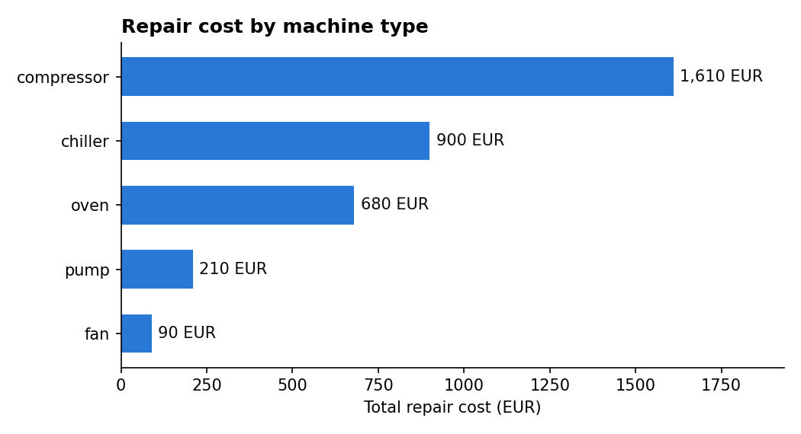
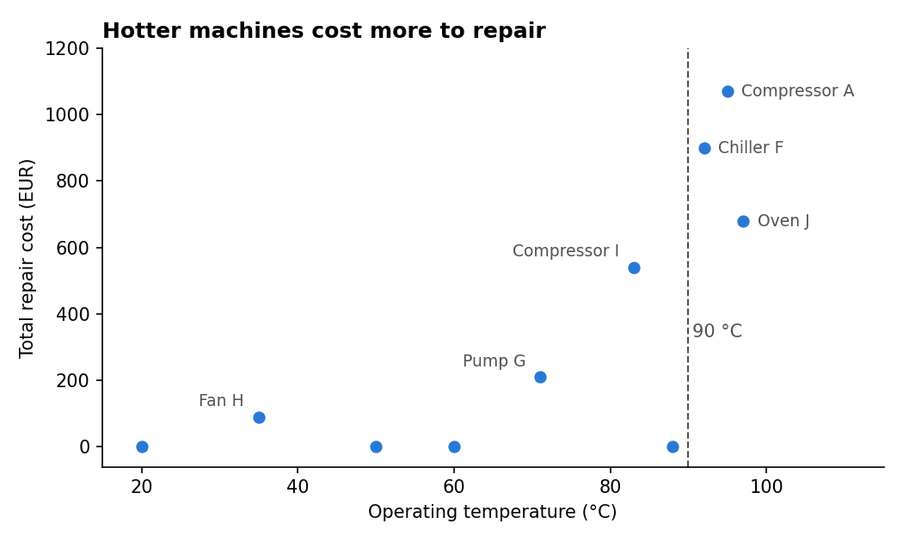

# 🏭 Factory Maintenance Analysis with SQL

**Where is the factory's maintenance money going, and what should we fix first?**

This project uses **SQL (SQLite)** to combine two tables, machine data and repair records, and answers 7 business questions for a plant manager.

**Tools:** SQL (JOIN, LEFT JOIN, GROUP BY, HAVING, aggregate functions) · Python · pandas · matplotlib · Google Colab

---

## 🔑 Key findings

| # | Finding | Number |
|---|---|---|
| 1 | Total repair spend | **3,490 EUR** (8 repairs) |
| 2 | Hot machines (> 90 °C) cause most of the cost | **2,650 EUR = 76%** from just 3 machines |
| 3 | Most expensive machine type | **Compressors**: 1,610 EUR (46%) |
| 4 | Most common issue | **Overheating**: 3 of 8 repairs (38%) |
| 5 | Repeat failures | **Compressor A** and **Oven J** (2 repairs each, both > 90 °C) |
| 6 | Machines never repaired | 4 machines, all running at **≤ 88 °C** |





---

## ✅ Recommendations

1. **Improve cooling on machines above 90 °C.** They cause three-quarters of all repair costs.
2. **Inspect compressors first.** They are the most expensive machine type to maintain.
3. **Put Compressor A and Oven J on a preventive maintenance plan**, since both have failed twice.
4. **Next step:** monitor temperature over time to predict failures before they happen (predictive maintenance).

---

## 🧮 The 7 business questions

| # | Question | SQL skills used |
|---|---|---|
| Q1 | How much did we spend on repairs in total? | `SUM` |
| Q2 | Which machine type costs the most to repair? | `JOIN`, `GROUP BY`, `ORDER BY` |
| Q3 | What is the most common issue? | `COUNT`, `GROUP BY` |
| Q4 | How much do hot machines (> 90 °C) cost us? | `JOIN`, `WHERE`, `SUM` |
| Q5 | Which machines had more than 1 repair? | `GROUP BY`, `HAVING` |
| Q6 | Which machines never needed a repair? | `LEFT JOIN`, `IS NULL` |
| Q7 | Repairs per machine, including 0 | `LEFT JOIN`, `COUNT(column)` |

**Example query (Q4):**

```sql
SELECT SUM(maintenance.repair_cost_eur) AS hot_cost
FROM maintenance
JOIN machines ON maintenance.machine = machines.machine
WHERE machines.temp_c > 90;
```

All queries and results are in [`Factory_Maintenance_SQL.ipynb`](Factory_Maintenance_SQL.ipynb).

---

## 📁 Files

| File | Content |
|---|---|
| `Factory_Maintenance_SQL.ipynb` | Notebook with all SQL queries, results, insights and charts |
| `factory.csv` | `machines` table: machine, type, power_kw, hours, temp_c |
| `maintenance.csv` | `maintenance` table: machine, month, repair_cost_eur, issue |
| `repair_cost_by_type.png` | Chart: repair cost per machine type |
| `temperature_vs_repair_cost.png` | Chart: operating temperature vs repair cost |

**Data:** a small sample dataset created for practice (10 machines, 8 repairs).

---

## 👤 About

**Ayush Ramtekkar**: M.Sc. student in AI / Data Science & Digital Business (Gisma, Berlin) with a B.E. in Mechanical Engineering. Looking for a **Werkstudent role in data analytics**, ideally in energy, cleantech or manufacturing.

📊 See also: [Factory Energy Analysis (Python & pandas)](https://github.com/ayushramtekkar/factory-energy-analysis)
